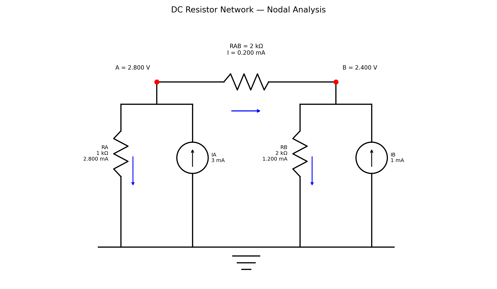

# DC Resistor Network Solver (Nodal Analysis)

A Python program that finds the voltage at every node and the current through every resistor in a DC circuit made of resistors and current sources. It sets up the circuit equations as a matrix, solves them with NumPy, and then **checks its own answer** in several independent ways.



## Why I built this

While preparing for JEE I solved many circuit problems by hand using Kirchhoff's laws. I wanted to see whether the same method could be turned into a short program that works for any resistor network, not just one circuit. It is the second project in a series: the first ([projectile motion](https://github.com/Faris-gitgud/Projectile-motion-visualiser)) was about checking a simulation against an exact answer, and this one is about turning circuit laws into a matrix problem and testing it.

## The idea in four steps

**1. Pick unknowns.** Every junction is a *node*. Ground is the reference (0 V). The unknowns are the node voltages.

**2. Write Kirchhoff's Current Law (KCL) at each node.** Current injected into a node = current leaving it through the resistors. For the example circuit (nodes A and B):

$$\frac{V_A}{R_A} + \frac{V_A - V_B}{R_{AB}} = I_A \qquad\qquad \frac{V_B}{R_B} + \frac{V_B - V_A}{R_{AB}} = I_B$$

**3. Write it as a matrix equation.** Using conductance $G = 1/R$, these become

$$G\,V = I \quad\Longrightarrow\quad \begin{bmatrix} 1.5 & -0.5 \\ -0.5 & 1.0 \end{bmatrix}\begin{bmatrix} V_A \\ V_B \end{bmatrix} = \begin{bmatrix} 3 \\ 1 \end{bmatrix} \quad (\text{mS, V, mA})$$

**4. Solve.** The code calls `np.linalg.solve`. By hand: the second row gives $V_B = 1 + 0.5\,V_A$. Substituting into the first row gives $1.25\,V_A = 3.5$, so $V_A = 2.8$ V and $V_B = 2.4$ V.

## How the matrix is built ("stamping")

Rather than writing equations by hand, the program loops over the resistor list and adds each one into the matrix. A resistor with conductance $g = 1/R$ between nodes $a$ and $b$ does this:

| Matrix entry | Change |
|---|---|
| `G[a, a]` | `+ g` |
| `G[b, b]` | `+ g` |
| `G[a, b]` and `G[b, a]` | `- g` |

If one end is ground, only `G[a, a] += g` is needed. This is why the same code works for any number of nodes: each resistor only touches its own entries.

## Circuit description

```python
resistors = [
    (0, None, 1000),   # node A to ground, 1 kOhm
    (1, None, 2000),   # node B to ground, 2 kOhm
    (0, 1, 2000),      # node A to node B, 2 kOhm
]
injections = [0.003, 0.001]   # amperes injected into A and B
```

Nodes are numbered from 0. `None` means ground.

## Results

| Quantity | Result |
|---|---:|
| Node voltage $V_A$ | 2.800 V |
| Node voltage $V_B$ | 2.400 V |
| Current through $R_A$ (A to ground) | 2.800 mA |
| Current through $R_B$ (B to ground) | 1.200 mA |
| Current through $R_{AB}$ (A to B) | 0.200 mA |

These match the hand calculation above. Sanity check at node A: 2.8 mA leaves through $R_A$ and 0.2 mA through $R_{AB}$, which adds up to the 3 mA injected.

## How I check the answer

Different checks catch different kinds of mistake, so the program uses several:

1. **Matrix residual** ($|GV - I|$). This only confirms that NumPy solved the equation I gave it. It cannot catch a mistake in how I built $G$.
2. **KCL from branch currents.** The program recomputes each resistor's current from Ohm's law and checks that the currents at every node add up to the injected current. This does not use $G$, so it **can** catch a mistake in the stamping.
3. **Known-answer tests** (`run_tests()` in the script):
   - A single resistor: $V = IR$.
   - Two resistors in series, worked out by hand.
   - The main example, solved by hand (2.8 V and 2.4 V).
   - A **balanced Wheatstone bridge**: when $R_1/R_3 = R_2/R_4$, the two middle nodes must be at the same voltage and no current flows in the bridge resistor. The test confirms this for a three-node circuit, then changes one resistor and confirms the bridge becomes unbalanced.
   - Bad input (zero or negative resistance, a node that does not exist) is rejected with an error.

All of these run automatically every time the script starts.

## How to run

```bash
pip install numpy matplotlib
python circuit_visualiser.py
```

The script runs the tests, prints the solution and the checks, shows the diagram, and saves it as `circuit_diagram.png`.

## Files

| File | Purpose |
|---|---|
| `circuit_visualiser.py` | Solver, checks, tests and diagram |
| `circuit_diagram.png` | Output diagram for the example circuit |

## Limitations

- Only ideal resistors and ideal **current** sources. There are no voltage sources, capacitors, inductors, AC behaviour or nonlinear parts.
- The solver works for any number of nodes, but the **drawing code is written only for the two-node example**.
- If part of a circuit has no path to ground, the matrix is singular and the program stops with an error message instead of returning a wrong answer.
- The tests show the solver behaves correctly on these circuits. They do not prove it is correct for every possible circuit.

## What I would do next

- Add **voltage sources**, which requires extending nodal analysis to *modified nodal analysis* (adding extra unknowns for source currents).
- Add **capacitors and inductors** and step the circuit forward in time, so I can compare the numerical result with the exact RC response. This links back to the timestep and convergence analysis in my projectile project.
